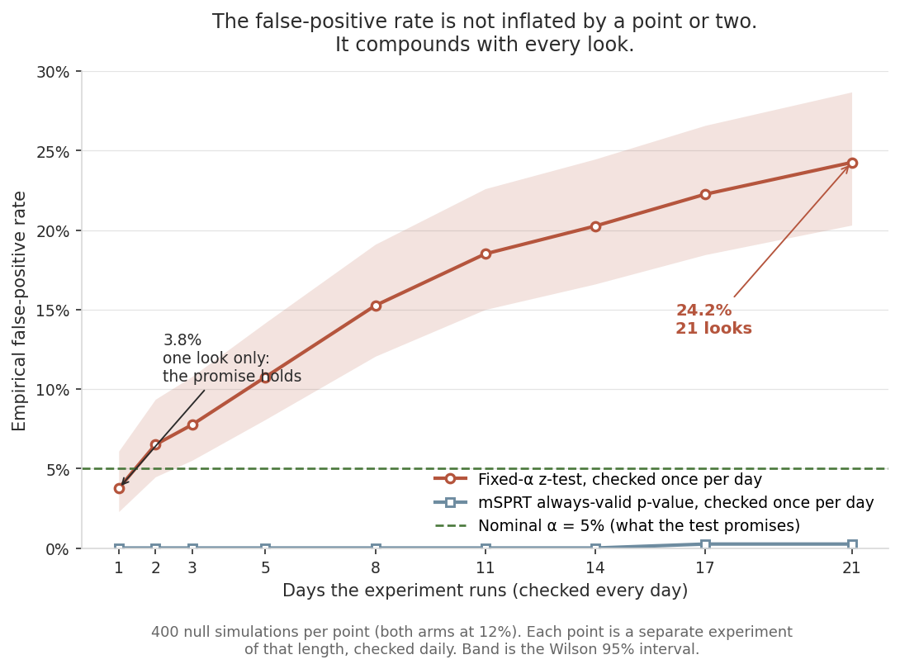
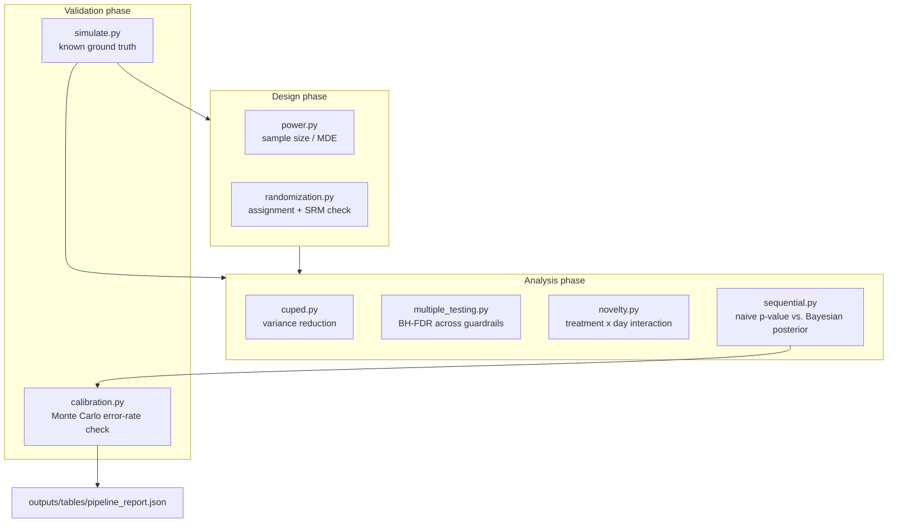
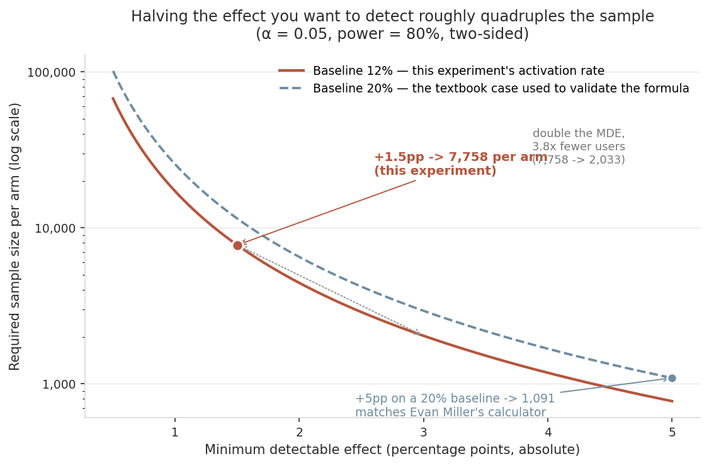
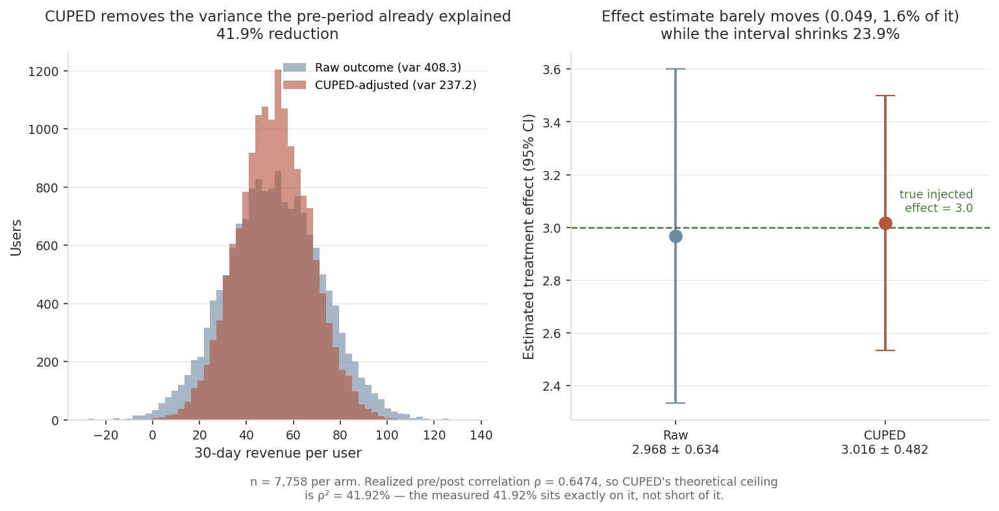
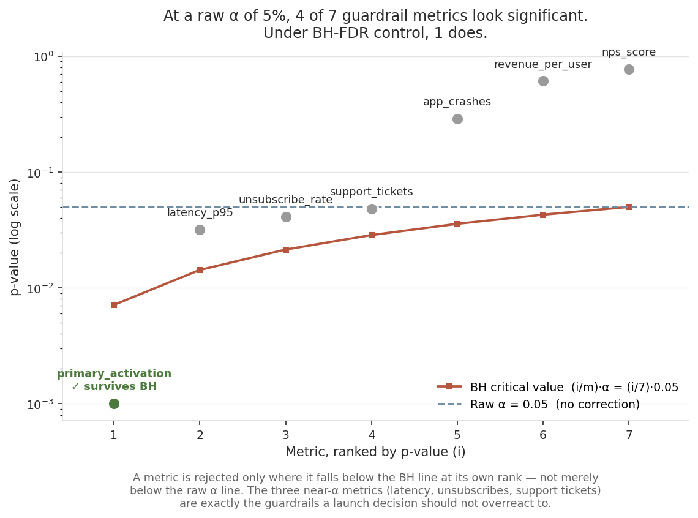
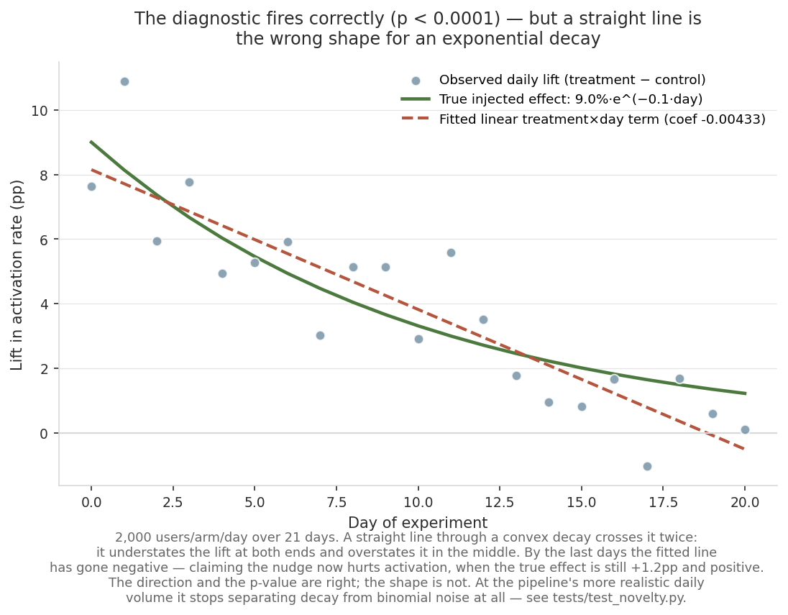
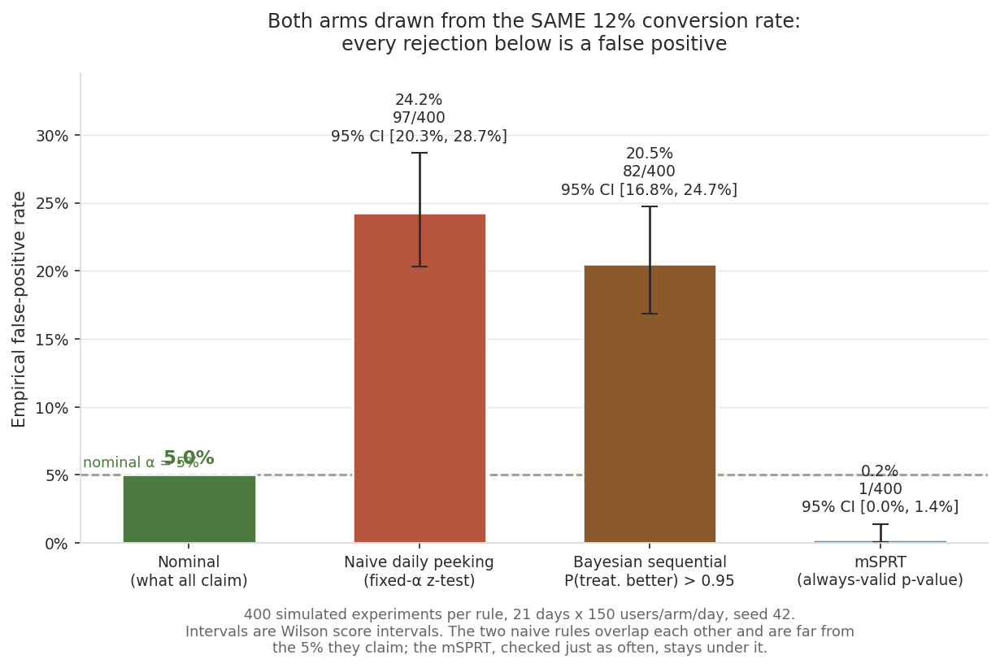
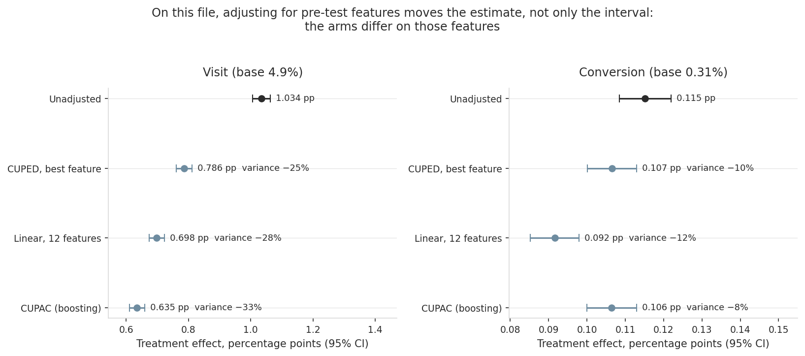
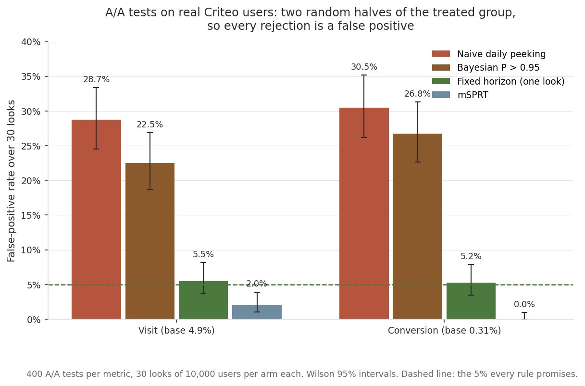
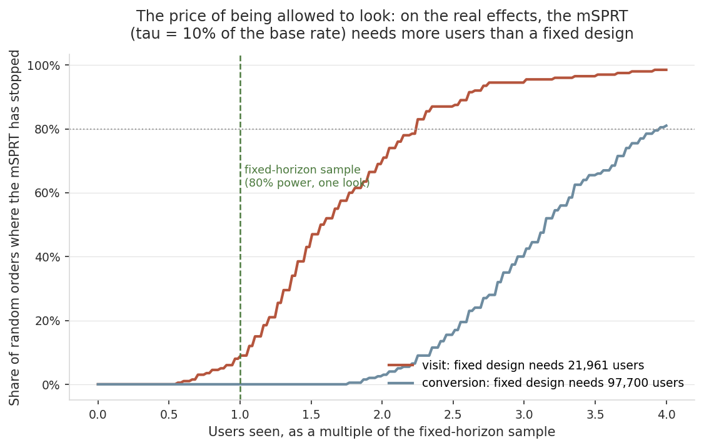

[English ] | [[Español](README.es.md) ]

# chile-fintech-experimentation-lab

A/B testing done the way a real experimentation platform has to do it: power analysis before launch, Sample Ratio Mismatch (SRM) detection, CUPED variance reduction, multiple-testing correction across guardrail metrics, a novelty-effect check — and, as the centerpiece, an empirical calibration harness that runs each stopping rule thousands of times under a *known* ground truth to check whether it actually controls the error rate it claims to.

**Scenario**: a Chilean fintech app tests an in-app nudge that offers to auto-enroll users in a savings product, aiming to lift 30-day activation. All data is simulated with a known, deliberately injected effect — the only way any of these techniques can be validated against a real answer, since with a real experiment you never know the ground truth. Every number below is from an actual run of `python -m src.pipeline` (seed 42).

**The headline finding**: checking a fixed-alpha test every day instead of once at the planned sample size doesn't inflate the false-positive rate from 5% to 6% or 7% — it inflates it to **24.2%**. Switching to a Bayesian posterior-probability stopping rule, commonly assumed to be "safe to peek", barely helps: **20.5%**. Neither naive method is safe. That's the point of building a calibration harness instead of trusting the textbook guarantee on faith. The mixture SPRT (`msprt.py`), an always-valid p-value built to be checked at every look, stays at **0.2%** under the same daily peeking, and section 7 repeats all of this on a real 14-million-user experiment.

The inflation is not a fixed penalty you could correct for once — it compounds with every look:



At a single look the test delivers what it promises (3.8%, consistent with the nominal 5%). The damage is done by the decision to keep looking, and it accumulates with each additional day.

## Architecture



## Results from an actual run

### 1. Power analysis

| | |
|---|---:|
| Baseline activation rate | 12.0% |
| Minimum detectable effect (absolute) | +1.5 pp |
| Required sample size per arm | **7,758** |



Verified against a known textbook case in `tests/test_power.py`: baseline 20%, MDE +5pp absolute, alpha=0.05, power=0.80 reproduces **1,091 per arm**, matching Evan Miller's public A/B testing sample-size calculator for the identical input, hand-checked from the pooled-variance formula. That validation point is the blue marker on the chart.

**How to read it**: the y-axis is logarithmic, so the curve's steepness at the left is the real cost of ambition. Doubling the MDE from +1.5pp to +3.0pp cuts the requirement from 7,758 to 2,033 per arm — a factor of 3.8, close to the quadrupling the inverse-square relationship implies. Deciding you care about a half-point smaller effect is not a small change to the experiment's budget; at this baseline it is most of it.

### 2. Randomization + SRM check

7,758 vs. 7,758 (exact, by block randomization) — SRM p-value = 1.0000, no mismatch. The check itself is validated in `tests/test_randomization.py` against a genuine 47/53 split on 20k units, which it correctly flags.

### 3. CUPED variance reduction

| | Before | After |
|---|---:|---:|
| Variance | 408.33 | 237.17 |



**41.9% variance reduction** using a pre-period revenue covariate. The pipeline specifies a correlation of 0.65; the realized correlation in the sample is ρ = 0.6474, so CUPED's theoretical ceiling here is ρ² = **41.92%** — and the measured reduction is **41.9168%**, sitting exactly on the ceiling rather than short of it. (The reduction CUPED achieves *is* the empirical ρ², which is why the two agree to four decimals. The only gap worth naming is between the realized ρ and the 0.65 specified, which is ordinary sampling error in the correlation itself, not slack in the method.)

On the treatment effect: CUPED is unbiased, so it does not systematically move the estimate — but in any finite sample the realized point estimate shifts slightly, because θ is estimated from the same data. Here it moves from 2.968 to 3.016, 1.6% of an injected effect of 3.0, while the 95% interval narrows by 23.9%. `tests/test_cuped.py` encodes exactly that: it asserts the two estimates agree *within a tolerance*, not that they are identical. CUPED buys a tighter interval around the same answer, not a different answer.

### 4. Multiple-testing correction (BH-FDR) across 7 guardrail metrics

| Metric | p-value | BH q-value | Reject at α=0.05? |
|---|---:|---:|:---:|
| primary_activation | 0.001 | 0.007 | **Yes** |
| latency_p95 | 0.032 | 0.084 | No |
| unsubscribe_rate | 0.041 | 0.084 | No |
| support_tickets | 0.048 | 0.084 | No |
| app_crashes | 0.290 | 0.406 | No |
| revenue_per_user | 0.610 | 0.712 | No |
| nps_score | 0.770 | 0.770 | No |



Read at a raw alpha=0.05, **4 of 7** metrics look significant. Under BH-FDR control, only **1** survives. Three of those four (latency, unsubscribe, support tickets) are exactly the guardrail metrics a launch decision should be most cautious about overreacting to — this is what the correction is for.

**How to read it**: a metric is rejected only where it falls below the red BH line *at its own rank*, which is a much harder bar than the flat raw-α line. The three near-α metrics sit below the dashed α line but above the BH line — visually, that is the entire difference between "four regressions, hold the launch" and "one real effect, the rest is the multiplicity you bought by measuring seven things".

### 5. Novelty-effect check



Interaction coefficient -0.00433, p < 0.0001 — correctly detects an injected decaying effect.

**What the chart adds that the coefficient hides**: a straight line through a convex decay crosses it twice, so the fit understates the lift at both ends and overstates it in the middle. By the final days the fitted line has gone *negative* — it says the nudge is now hurting activation, when the true effect is still +1.2pp and positive. The direction and the p-value are right; the shape is not, and the shape is what a "should we keep this feature?" decision actually turns on.

This diagnostic also has a real, measured power limit: at the pipeline's more realistic daily volume (`daily_n=500`, `true_effect=0.06`, `novelty_decay=0.12` over 30 days), the linear treatment×day term does **not** reliably separate a true exponential decay from per-day binomial noise (`tests/test_novelty.py` documents the exact scale — `daily_n=2000`, larger effect — needed for the test to pass reliably). A linear interaction term is the wrong functional form for a genuinely fast decay measured over few days; that limitation is stated here rather than hidden behind a lucky seed.

### 6. Calibration: does each stopping rule control what it claims to?

400 simulated experiments, both arms drawn from the **same** true conversion rate (12%), so any "significant" result is by definition a false positive:

| Method | Nominal error rate | Empirical false-positive rate |
|---|---:|---:|
| Naive daily peeking (fixed-α z-test, checked every day) | 5% | **24.2%** (97/400) |
| Bayesian sequential (stop when P(treatment better) > 0.95) | ~5% (assumed) | **20.5%** (82/400) |
| mSPRT always-valid p-value (`msprt.py`, tau = the planned MDE) | ≤ 5% (guaranteed) | **0.2%** (1/400) |



**One caveat the figure makes visible and the table does not**: the two Wilson intervals overlap ([20.3%, 28.7%] and [16.8%, 24.7%]). At 400 simulations the Bayesian rule is *not* distinguishable from the naive z-test — both are distinguishable from the 5% they claim, which is the finding, but "Bayesian is better than naive" is not something this evidence supports. Separating them would need more simulations.

`tests/test_calibration.py` locks in the naive method's inflation as a regression test (`> 10%`, well above the nominal 5%). Neither of the two naive methods is a safe way to monitor an experiment daily and stop early. The mixture SPRT of Johari et al. (2017), in `msprt.py`, is: its p-value is the running minimum of the inverse mixture likelihood ratio, a martingale under the null, so the chance it *ever* crosses α is at most α. Checked every day on the same 400 null experiments it rejects once (0.2%, Wilson interval [0.04%, 1.4%]); `tests/test_msprt.py` checks the closed form and that it stays near 5% where naive peeking exceeds 10%. It is conservative here because 21 looks are far fewer than the continuous monitoring its guarantee covers.

### 7. A real experiment: Criteo's 14-million-user incrementality test

Everything above runs on simulated data so the truth is known. `src/real_criteo.py` asks the other question: what do the same checks show on a real randomized experiment, where nobody wrote the truth down? The data is Criteo AI Lab's uplift benchmark v2.1 (Diemert et al., AdKDD 2018; CC BY-NC-SA 4.0): **13,979,592 users** of an ad incrementality test, 85% shown the advertiser's ads and 15% held out, 12 anonymised features measured before the test, and two outcomes over the following two weeks (visit and conversion).

**Randomization: the SRM check passes, and that is the suspicious part.** 11,882,655 users are treated against 11,882,653 expected at 85%: a deviation of 2 users when chance alone would typically put it about 1,335 away. A fair randomizer lands this close only 0.14% of the time. The pre-test features then tell the arms apart: standardized mean differences reach −0.049 (f3) and −0.040 (f6), where randomization on 14 million users would leave about 0.001, and a gradient-boosting classifier predicts the arm from the features with an AUC of **0.5087**, 14 standard errors above the 0.5 of a true coin flip. The released file was evidently rebalanced to the design after the fact. An SRM check cannot see that; a covariate balance check can.

**The effects** (intention to treat, users assigned to see ads against users held out):

| | Control | Treated | Difference (95% CI) | Relative |
|---|---:|---:|---:|---:|
| Visit | 3.820% | 4.854% | +1.034 pp [1.006, 1.063] | +27.1% |
| Conversion | 0.194% | 0.309% | +0.115 pp [0.108, 0.122] | +59.4% |

Only 3.6% of the treated users were actually exposed to an ad, so per exposed user (the Wald ratio) the effect is +28.7 points of visit probability and +3.2 points of conversion.

**CUPED on real features moves the estimate, not only the interval:**



| Adjustment | Visit: variance cut | Visit: effect | Conversion: variance cut | Conversion: effect |
|---|---:|---:|---:|---:|
| None | | 1.034 pp | | 0.115 pp |
| CUPED, best single feature | 24.5% | 0.786 pp | 9.8% | 0.107 pp |
| Linear, all 12 features | 28.0% | 0.698 pp | 11.9% | 0.092 pp |
| CUPAC (cross-fitted gradient boosting) | 33.4% | 0.635 pp | 7.9% | 0.106 pp |

Section 3's simulated CUPED cut variance by 41.9% and left the estimate where it was, as it should when the arms are balanced. On this file the variance cut is smaller (8-33%), and the estimate itself falls by up to 39% for visits, far outside the unadjusted interval, because the arms differ on the very features being adjusted for. Which number is right depends on why the arms differ, which the file does not say; what it does say is that "CUPED never changes the point estimate" is a property of a clean randomization, not of CUPED.

**Peeking on real rows.** 400 A/A tests per metric, each two random halves of the treated users (so there is no true difference), checked 30 times at 10,000 users per arm per look:



| Rule | Visit (base 4.9%) | Conversion (base 0.31%) |
|---|---:|---:|
| Naive daily peeking | 28.7% | 30.5% |
| Bayesian, stop at P > 0.95 | 22.5% | 26.8% |
| Fixed horizon (one look) | 5.5% | 5.3% |
| **mSPRT** | **2.0%** | **0.0%** |

The simulated finding holds on real data and a rare outcome: looking every day at a test built to be looked at once multiplies its error rate by about six, the Bayesian rule barely helps, and the mSPRT stays under 5% whatever the metric.

**What the mSPRT costs.** Streaming the real users in 200 random orders, the fixed-horizon test needs 21,961 users to detect the visit effect with 80% power, and 97,700 for conversions. With its mixing scale set to 10% of the base rate, the mSPRT reaches a decision by the fixed-horizon sample in only 9% (visit) and 0% (conversion) of the orders; its median stopping point is 1.6 and 3.2 times that sample:



The cost depends on the mixing scale: at 30% of the base rate the median falls to 1.2× (visit) and 1.6× (conversion), at 100% to 1.4× and 1.3×, and the A/A false-positive rate stays between 0% and 3% at every setting. Being allowed to look whenever you want is paid for in users, more so when the guess about the effect size is off.

## Toolkit

| Module | What it does |
|---|---|
| `power.py` | Two-proportion and two-mean sample-size formulas, plus the MDE inverse solved by bisection |
| `randomization.py` | Block randomization to an exact ratio, and a chi-square Sample Ratio Mismatch check (α=0.005, the standard SRM threshold) |
| `cuped.py` | Pre-period-covariate variance reduction; verified to leave the treatment-effect point estimate unchanged |
| `multiple_testing.py` | Benjamini-Hochberg FDR control across a guardrail-metric panel |
| `novelty.py` | Treatment×day OLS interaction with HC1 robust standard errors — required because the underlying outcome is binary (a linear probability model), which is heteroskedastic by construction |
| `sequential.py` | A naive fixed-alpha p-value and a Bayesian Beta-Bernoulli posterior probability, both computable at any point in an experiment |
| `simulate.py` | Data-generating processes with a known, controllable ground truth — daily binary-conversion experiments (with optional novelty decay) and single-snapshot continuous outcomes with an exact-correlation pre-period covariate |
| `calibration.py` | Repeats a full simulated experiment thousands of times under the null to measure each stopping rule's real false-positive rate |
| `msprt.py` | The mixture sequential probability ratio test: an always-valid p-value for two proportions that can be checked at every look |
| `real_criteo.py` | Section 7: randomization checks, effects, CUPED/CUPAC, A/A peeking and mSPRT detection on Criteo's real experiment |
| `real_figures.py` | Redraws section 7's figures from `outputs/tables/real_criteo.json`, without the data |
| `make_figures.py` | Redraws every figure in this README from the same functions, constants and seed the pipeline uses — nothing here is illustrative |

## A real bug found while building this

`novelty.py`'s diagnostic function was originally named `test_novelty_effect`. Once imported into `tests/test_novelty.py`, pytest's collector picked up the imported name — anything matching `test_*` that it can import — and tried to run it directly as a test, failing on missing fixtures. Renamed to `detect_novelty_effect`; the collision and the fix are both documented in the module's own docstring.

A third one, found while drawing the figures rather than while writing the code: this README used to describe the CUPED covariate as having "a real 0.70 correlation" against "the theoretical bound of ρ² ≈ 49%", calling the 7-point shortfall finite-sample noise. The pipeline passes `covariate_correlation=0.65`, so the bound was never 49% — and the measured reduction matches the realized ρ² to four decimal places, with no shortfall to explain. Plotting the thing is what surfaced it: the number had been carried in prose without being recomputed against the parameter the code actually uses.

Separately, the same function's first version used plain OLS standard errors on a binary (0/1) outcome — a linear probability model, whose variance is `p(x)(1-p(x))` and therefore changes with `x` by construction. Classical OLS assumes constant variance; switching to HC1 heteroskedasticity-robust standard errors was necessary to get the novelty-effect false-alarm rate under control on a genuinely null (constant-effect) dataset.

## Running it end to end

```bash
python -m venv .venv
.venv/Scripts/activate   # or source .venv/bin/activate on Linux/macOS
pip install -r requirements.txt
python -m pytest -v        # 42 tests, none mocked
python -m src.pipeline     # full report, prints to console + outputs/tables/pipeline_report.json
python -m src.make_figures # redraws the six figures above into outputs/figures/

# Section 7: ~340 MB from Kaggle (Criteo's own link no longer resolves), then ~8 minutes
kaggle datasets download arashnic/uplift-modeling -p data/raw
python -m src.real_criteo   # writes outputs/tables/real_criteo.json
python -m src.real_figures  # redraws section 7's figures from that file
```

`make_figures.py` imports the same functions and reuses the same constants and seed (42) as `pipeline.py`, so the numbers annotated on the charts are the numbers the pipeline prints. Running it is how you check that.

## License

MIT — see [LICENSE](LICENSE).
